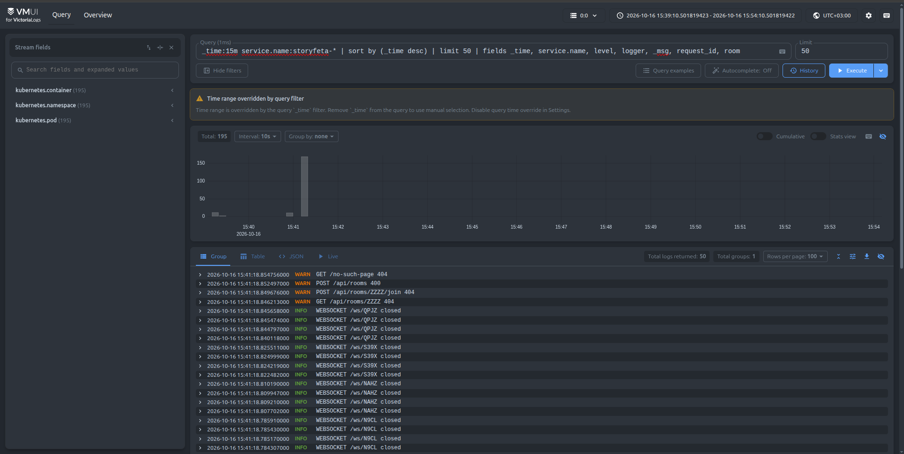
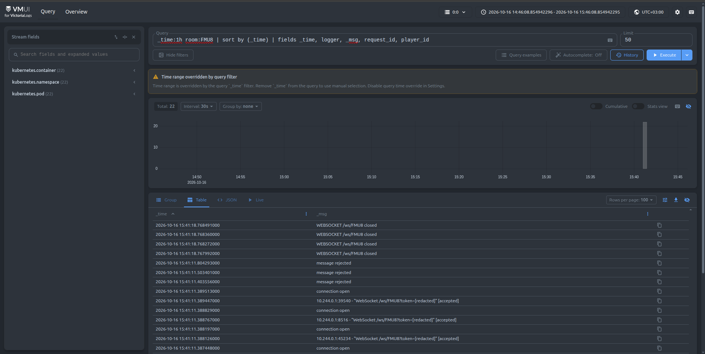
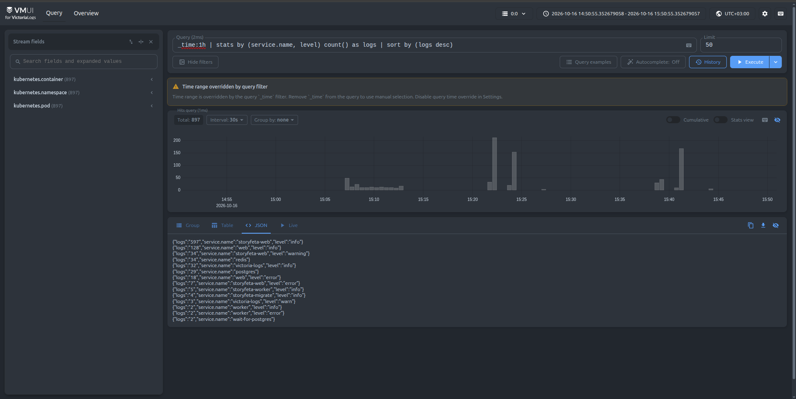
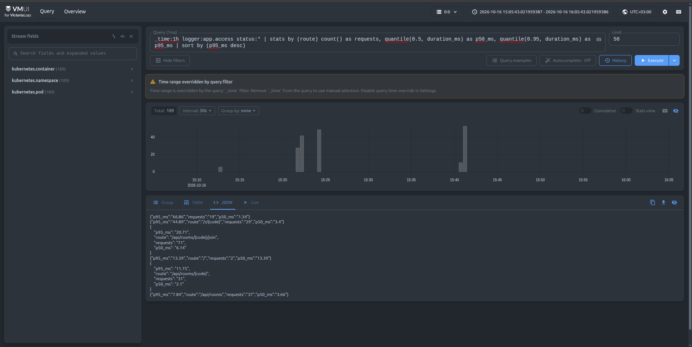
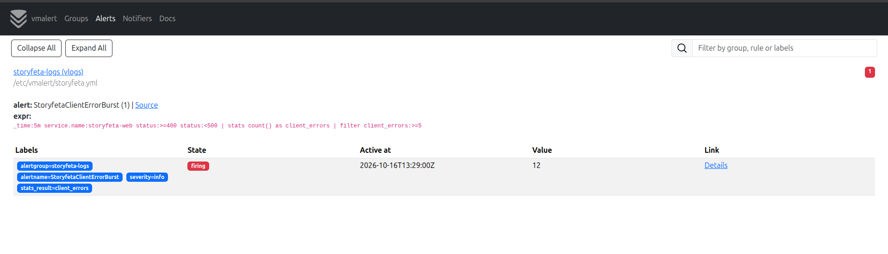
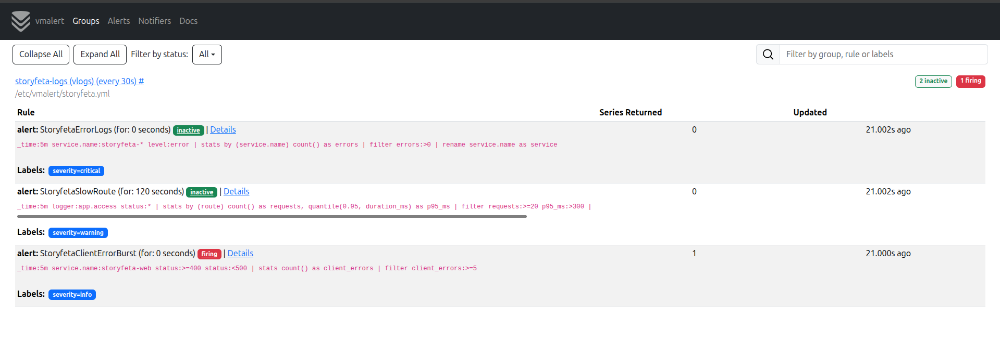

# Отчёт: логи Storyfeta в VictoriaLogs

```
pod stdout (JSON) ─▶ /var/log/pods ─▶ Vector (DaemonSet) ─▶ VictoriaLogs ─▶ vmui
```

Приложение пишет в stdout по одной JSON-строке на событие: `timestamp`, `level`, `message`,
`service.name`, `service.version`, `env`, `logger`, а также `request_id`, `room` и `player_id`,
чтобы связывать строки одного запроса и одной игры. Строка доступа содержит `method`, `route`,
`status` и `duration_ms`.

Манифесты: `k8s/40-victoria-logs.yml` (VictoriaLogs single-node, PVC, Service),
`k8s/41-vector.yml` (Vector), `k8s/42-vmalert.yml` (бонус).

## Почему Vector как DaemonSet

- **Приложение не знает о бэкенде логов** (12-factor): оно только пишет в stdout. Прямой push из
  кода связал бы приложение с VictoriaLogs, а логи терялись бы при его падении.
- **DaemonSet, а не сайдкар**: один сборщик на ноду читает логи всех подов, включая postgres и
  redis, и не требует правок в их манифестах.
- **Vector, а не Fluent Bit или OTel Collector**: источник `kubernetes_logs` сам добавляет
  namespace, pod и container, а разбор JSON и переименование полей — несколько строк VRL.
  OTel Collector для одних только логов слишком тяжёлый.
- **Stream-поля** — namespace, pod, container: их значений мало. `request_id` и `room`
  остаются обычными полями, потому что уникальных значений у них слишком много.

## Запросы

Скриншоты сделаны в vmui (`kubectl port-forward svc/victoria-logs 9428:9428`,
<http://localhost:9428/select/vmui/>) после прогона `scripts/generate_traffic.py`. Скрипт играет
несколько партий и делает намеренные ошибки: несуществующая комната, пустой ник, 404.

### (а) Сырые записи за последние 15 минут

```logsql
_time:15m service.name:storyfeta-* | sort by (_time desc) | limit 50
  | fields _time, service.name, level, logger, _msg, request_id, room
```

Последние записи наших сервисов, свежие сверху. Видны конец партий (`WEBSOCKET … closed`) и
намеренные ошибки генератора с уровнем `WARN`.



### (б) Фильтр по полю

```logsql
_time:1h room:FMU8 | sort by (_time) | fields _time, logger, _msg, request_id, player_id
```

Одна партия целиком: создание комнаты, три входа игроков, четыре WebSocket-соединения,
отклонённые сообщения, закрытие сокетов. Это 22 строки из разных эндпоинтов и реплик, и связывает
их поле `room`. Токен сессии в URL сокета заменён на `[redacted]`.



### (в) stats с группировкой

```logsql
_time:1h | stats by (service.name, level) count() as logs | sort by (logs desc)
```

Сколько строк каждого уровня пишет каждый сервис. `web` и `worker` — старые поды до новой схемы
логов: Vector подставил вместо `service.name` имя контейнера. У `redis` и `postgres` уровня нет,
потому что они пишут текст.



### (г) Агрегирующий запрос: quantile

```logsql
_time:1h logger:app.access status:*
  | stats by (route) count() as requests,
      quantile(0.5, duration_ms) as p50_ms, quantile(0.95, duration_ms) as p95_ms
  | sort by (p95_ms desc)
```

Латентность p50 и p95 по маршрутам. Группировка по `route` (шаблону вида
`/api/rooms/{code}/join`), а не по `path`, иначе каждая комната давала бы отдельную строку.
Самая высокая медиана среди API у `/join` (≈6 мс): чтение и запись комнаты в Redis.



## Бонус: алерт через vmalert

vmalert выполняет LogsQL-правила к VictoriaLogs раз в 30 секунд (`-rule.defaultRuleType=vlogs`).
Порог задаётся пайпом `filter`: нет строк — нет алерта. Alertmanager не подключён, алерты видны
в интерфейсе vmalert (`kubectl port-forward svc/vmalert 8880:8880`).

| Алерт | Условие |
|---|---|
| `StoryfetaErrorLogs` | хотя бы одна строка `level:error` за 5 минут |
| `StoryfetaSlowRoute` | p95 маршрута > 300 мс при ≥ 20 запросах (запрос (г) с порогом) |
| `StoryfetaClientErrorBurst` | ≥ 5 ответов 4xx за 5 минут |

После прогона генератора сработал `StoryfetaClientErrorBurst` (12 ответов 4xx):



